# roundtheworld — туристическое агентство

Статический демонстрационный лендинг: русский, английский и китайский языки, светлая/темная тема, фильтры направлений и подбор тура.

## Функционал

- Форма подбора тура, а также форма записи с возможностью последующего подключения.
- Разделы туров по направлениям.
- Возможность выбора одного из трех языков: русский, английский, китайский.
- Возможность выбора светлой/темной темы.

## Превью сайта

### Светлая тема

<table>
<a href="docs/screenshots/l1.png">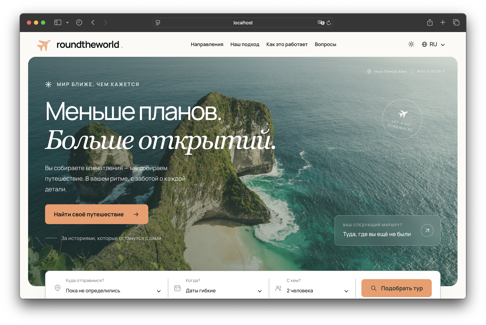</a>
<a href="docs/screenshots/l2.png">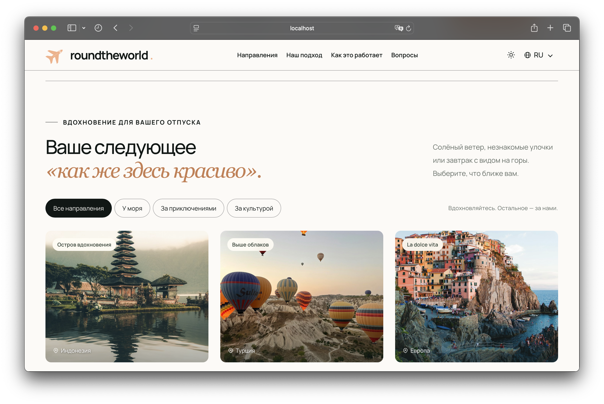</a>
<a href="docs/screenshots/l3.png">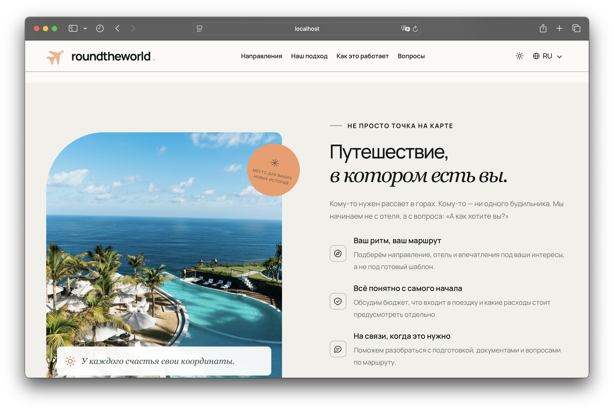</a>
<a href="docs/screenshots/l4.png">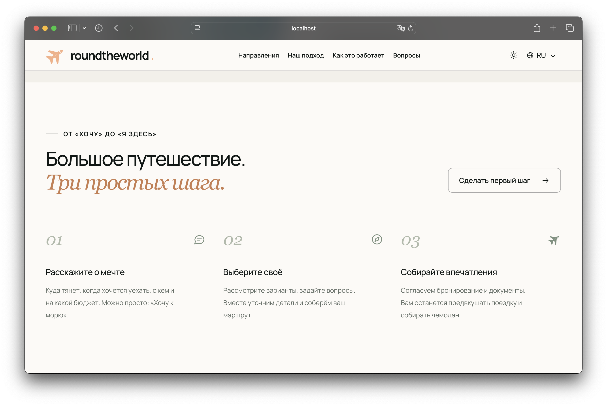</a>
<a href="docs/screenshots/l5.png">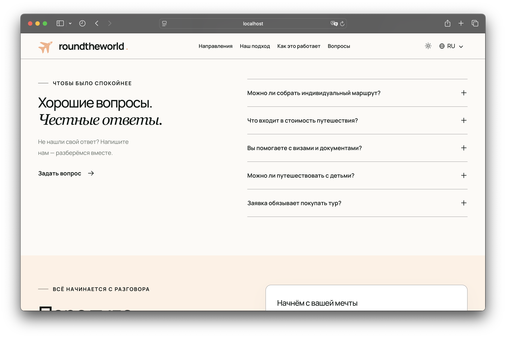</a>
<a href="docs/screenshots/l6.png">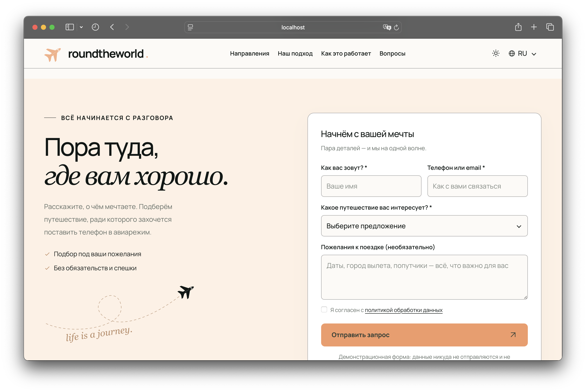</a>
</table>

### Тёмная тема

<table>
<a href="docs/screenshots/d1.png">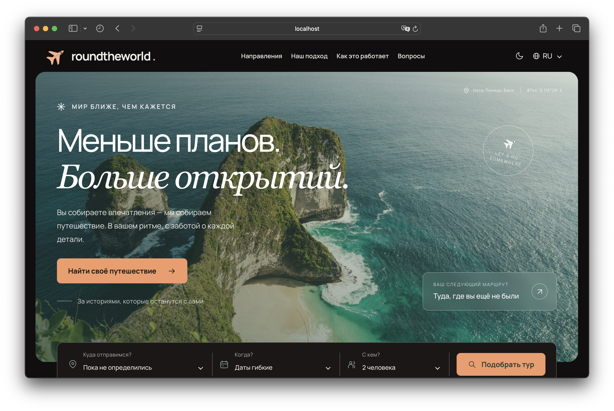</a>
<a href="docs/screenshots/d2.png">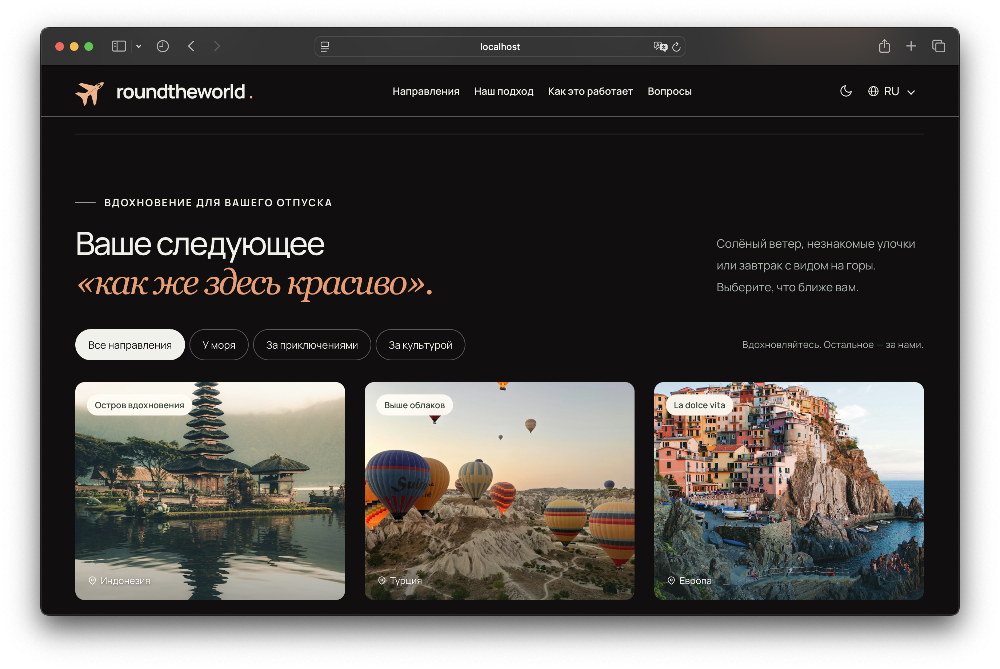</a>
<a href="docs/screenshots/d3.png">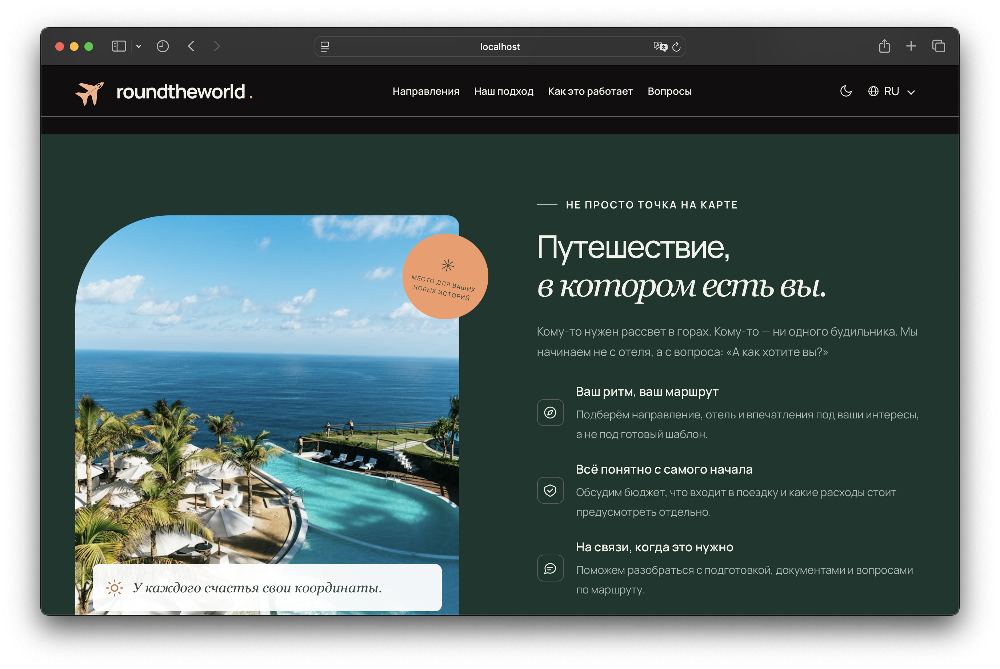</a>
<a href="docs/screenshots/d4.png">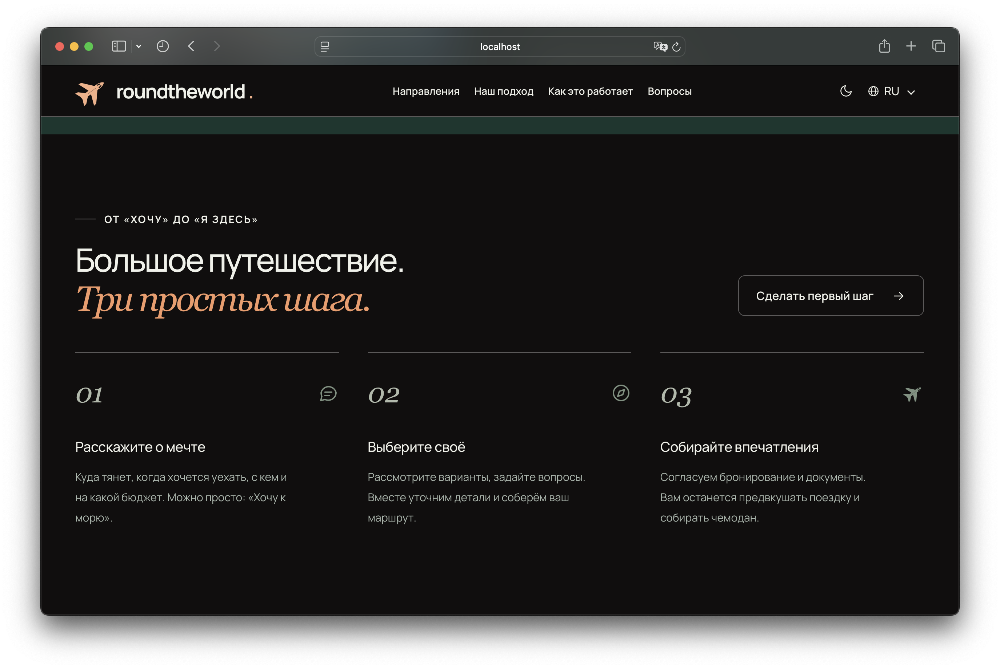</a>
<a href="docs/screenshots/d5.png">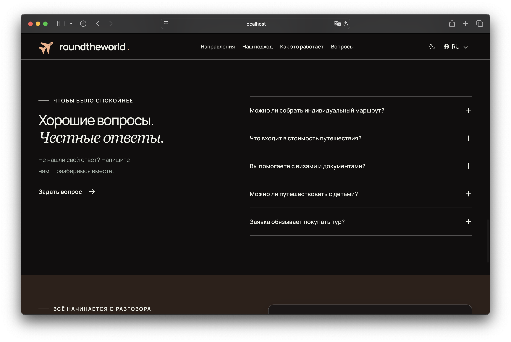</a>
<a href="docs/screenshots/d6.png">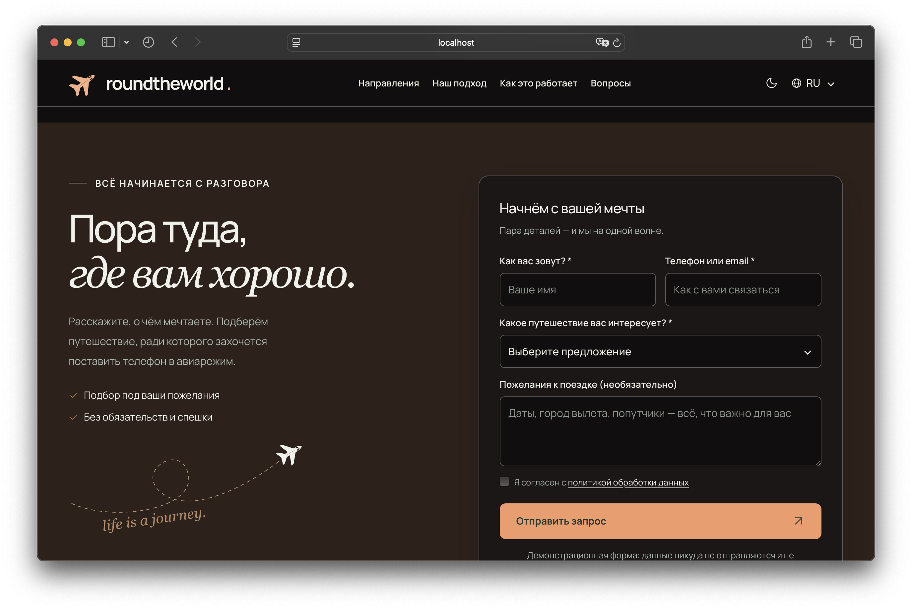</a>

</table>
